# Setup básico de la suscripción de Azure

## Suscripción
Se utilizará una cuenta de Azure for Students. Para confirmar la suscripción activa, se ejecuta:

```bash
az account show --query name -o tsv
```

El comando muestra:

```text
Azure for Students
```

## Configuración de valores por defecto
Se establece Belgium Central (Europe) como región predeterminada. Debido a las restricciones de la suscripción de Azure for Students, esta es la región en la que podemos operar:

```bash
az configure --defaults location=belgiumcentral
```

Se crea un nuevo grupo de recursos llamado `rg-practica2-dev-belgiumcentral-001` y lo configuramos como grupo de recursos predeterminado:

```bash
az configure --defaults group=rg-practica2-dev-belgiumcentral-001
```

Se puede comprobar la configuración con 
```bash
`az configure --list-defaults`
````

[
  {
    "name": "location",
    "source": "/home/pablo/.azure/config",
    "value": "belgiumcentral"
  },
  {
    "name": "group",
    "source": "/home/pablo/.azure/config",
    "value": "rg-practica2-dev-belgiumcentral-001"
  }
]


# Sección 1: Exploración de conceptos
## Diagrama de la suscripción y los grupos de recursos

- Vista de la suscripción de Azure
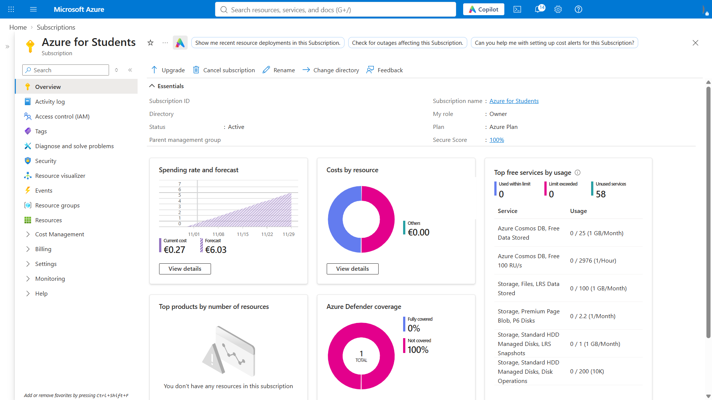

- Vista de los grupos de recursos de Azure
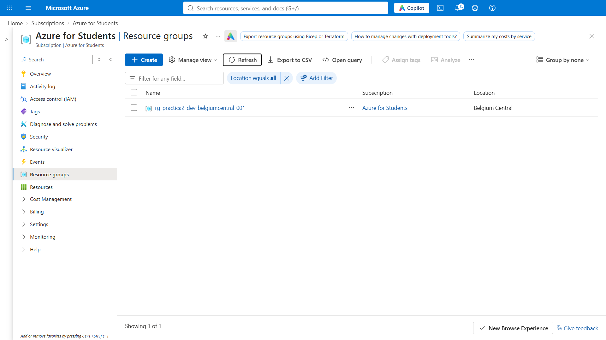


## Diferencia entre el plano de gobierno y el plano de red


## Comparativa de los conceptos organizativos de Azure, AWS y GCP


# Sección 2: Despliegue desde Azure Portal

## Configuración de la máquina virtual

En el portal de Azure inicié la creación de una máquina virtual en la suscripción **Azure for Students** y en el grupo de recursos `rg-practica2-dev-belgiumcentral-001`. La máquina se llamó `vm-linux-portal-01` y se ubicó en **Belgium Central**, zona de disponibilidad 1. Como imagen del sistema operativo seleccioné **Ubuntu Server 24.04 LTS** con seguridad de inicio confiable. Escogí el tamaño **Standard D2as_v4**, que proporciona 2 vCPU y 8 GiB de RAM, el cual era el tamaño predeterminado recomendado por el portal para esta imagen.

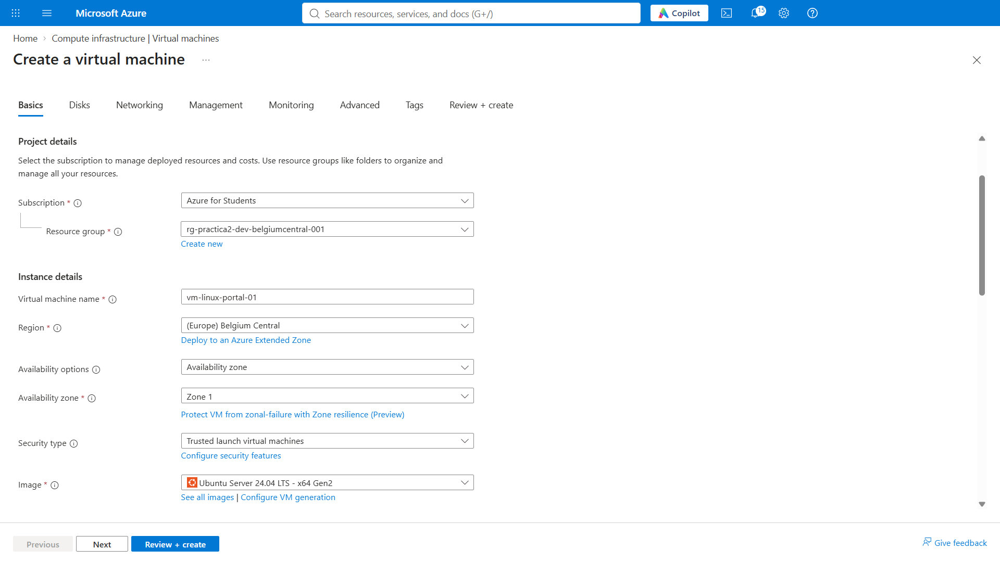

En la configuración de discos mantuve el tamaño predeterminado del disco del sistema operativo (30 GiB) y seleccioné **Standard SSD**. También dejé activada la opción para eliminar el disco junto con la máquina virtual.

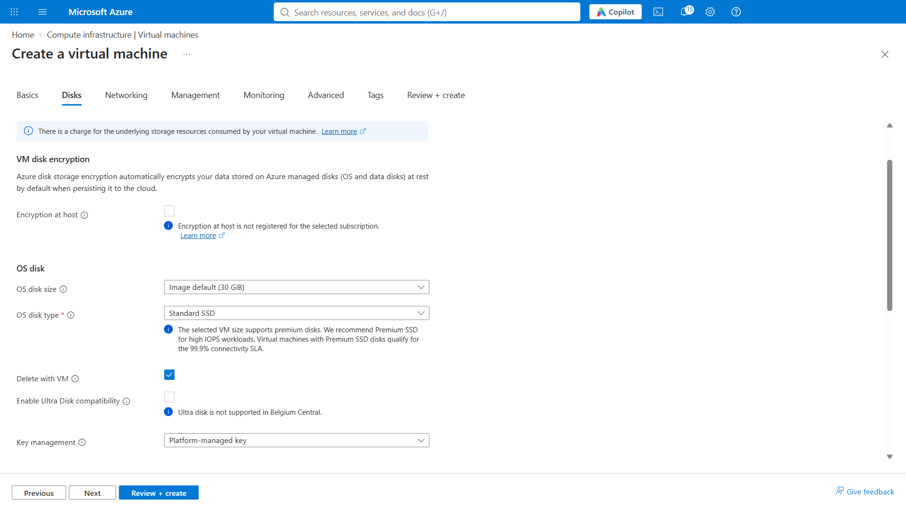

Para la conectividad se creó una red virtual, `vnet-ejercicio-portal-belgiumcentral`, con la subred `snet-belgiumcentral-1` y el rango `10.0.0.0/24`. El asistente también creó una IP pública y un grupo de seguridad de red para la interfaz de la máquina.

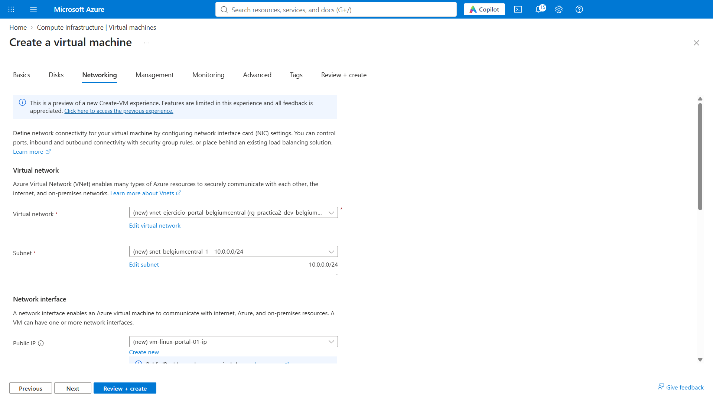

En Administración mantuve desactivadas la identidad administrada y la autenticación con Microsoft Entra ID. El portal indicó que el apagado automático no está disponible en esta región, por lo que no se pudo habilitar desde esta configuración.

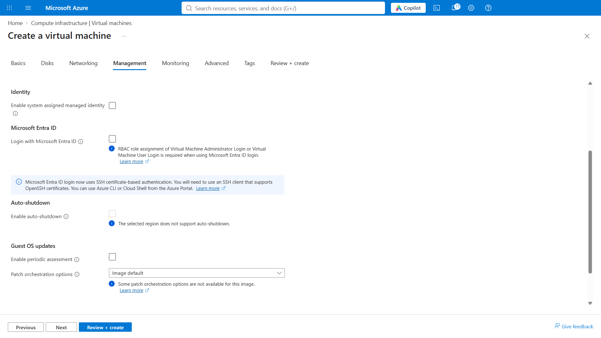

Añadí etiquetas para facilitar la identificación y organización de los recursos: `environment=development`, `project=practica-2`,  `created-by=portal` y `owner=pablo`.

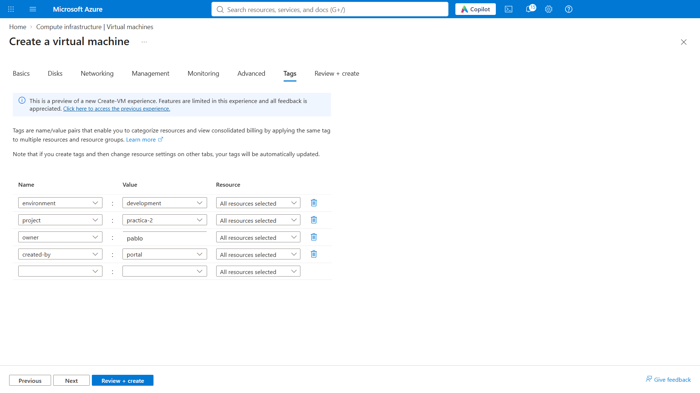

Antes de crearla, revisé el resumen de la configuración. Se confirmó el tamaño **Standard D2as_v4**, Ubuntu 24.04 LTS y la autenticación mediante clave pública SSH para el usuario `azureuser`; el puerto SSH (22) quedó seleccionado como puerto de entrada.

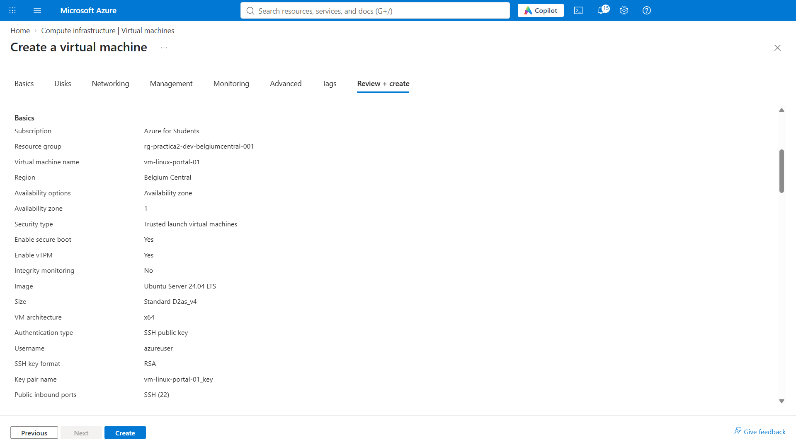

El resumen también muestra el disco administrado y los recursos de red que se crearían: red virtual, subred, IP pública y grupo de seguridad.

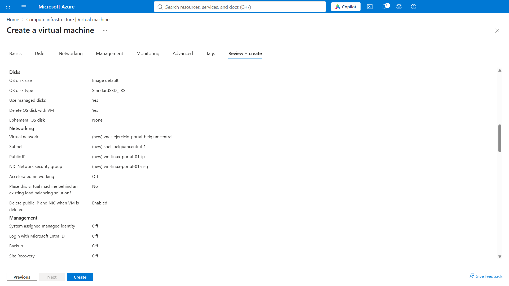

## Creación y recursos desplegados

El portal confirmó que el despliegue terminó correctamente. Después, en la vista del grupo de recursos, aparecen **siete recursos**: la máquina virtual, su interfaz de red, la IP pública, el grupo de seguridad de red, la clave SSH, el disco del sistema operativo y la red virtual.

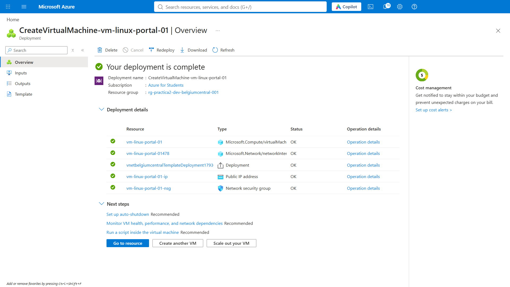

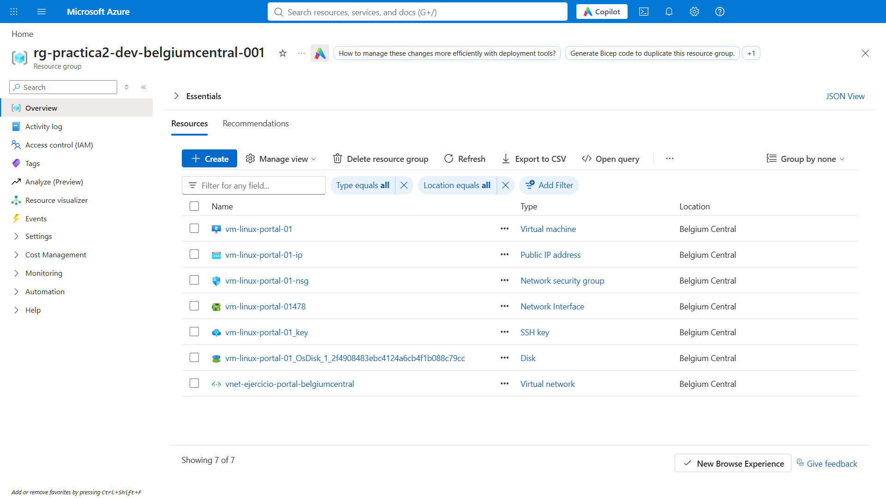

## Reglas de red y comprobaciones

En las reglas de entrada del grupo de seguridad se configuraron dos permisos: **SSH/TCP 22** y **HTTP/TCP 80**. La captura muestra que la regla SSH acepta tráfico desde cualquier origen (`Any`); para un entorno real convendría limitar el origen a una dirección o rango de confianza.

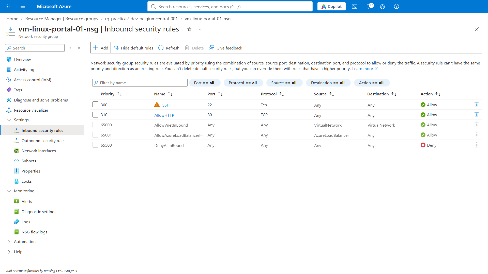

A continuación, inicié una sesión SSH con el usuario `azureuser` y la clave privada asociada. El terminal muestra el mensaje de bienvenida de Ubuntu y el prompt de la máquina, lo que confirma que la conexión se realizó correctamente.

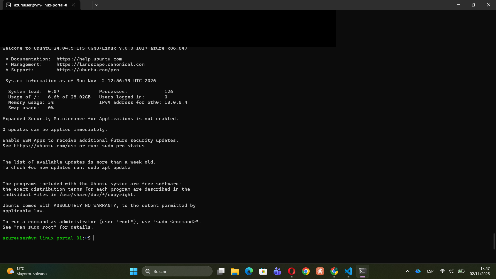

Por último, abrí en el navegador la dirección pública de la máquina. La página predeterminada de **nginx** se cargó correctamente, comprobando que el servidor web responde por HTTP desde fuera de la máquina.

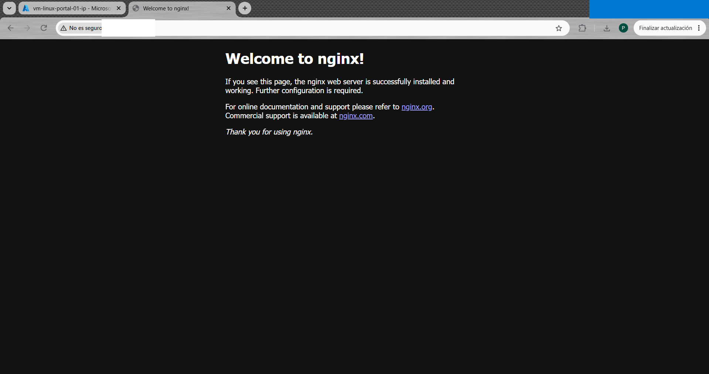

# Sección 3: Despliegue desde Azure CLI

## Script utilizado
## Recursos desplegados
## Conexión SSH y verificación

# Sección 4: Despliegue con Terraform
## Archivos de configuración
## Plan de ejecución
## Creación de recursos
## Salidas de Terraform
## Estado de Terraform
## Conceptos principales de Terraform

# Sección 5: Análisis de costos
## Análisis de costos de la suscripción
## Estimación de costos de los tres escenarios
## Presupuesto y alertas
## Estrategias de optimización
